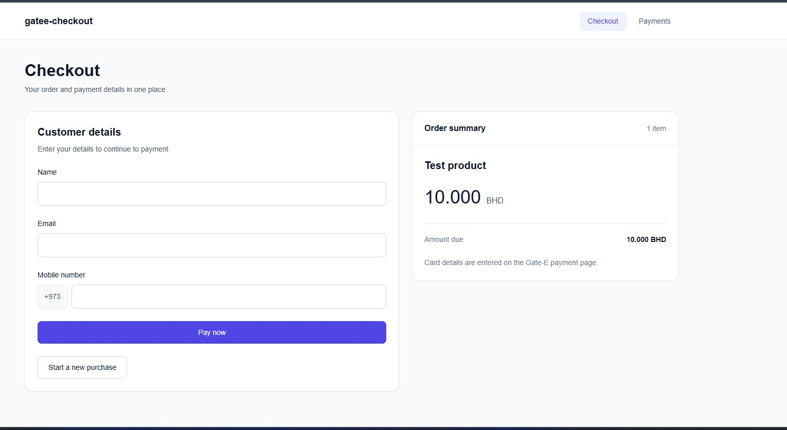
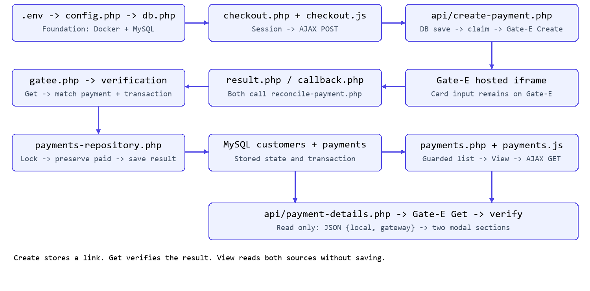
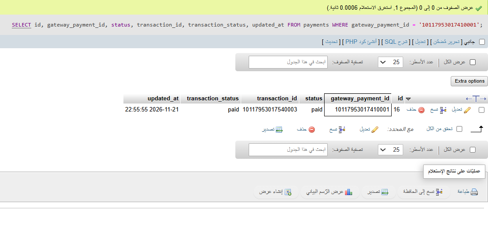
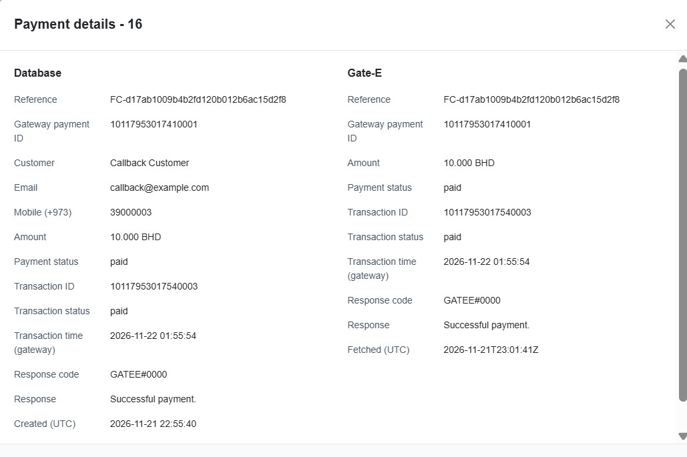
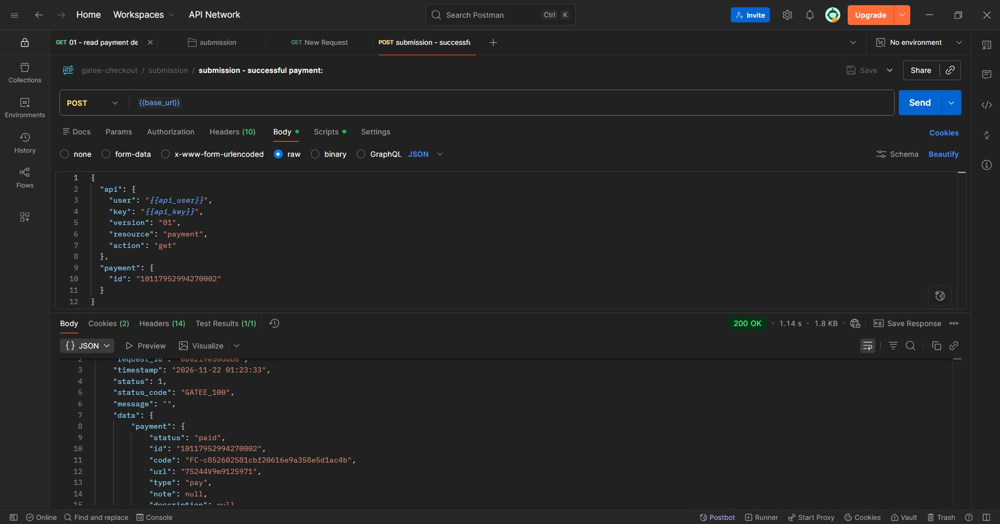
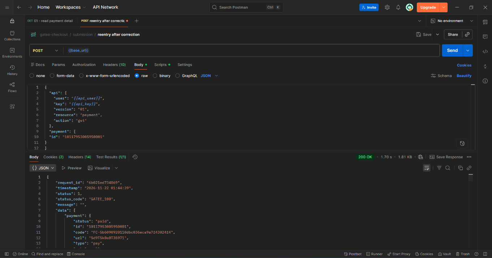
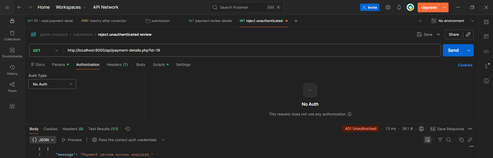

# gatee-checkout

A PHP checkout built for the Gate-E assessment. It collects customer details, creates a payment for **BHD 10.000**, and opens the hosted payment page inside an iframe.

Results are checked with Gate-E before being saved in MySQL. Card numbers and CVV values are not stored by the application.

**Stack:** PHP 8.3, MySQL 8.4, PDO, jQuery AJAX, Bootstrap and Docker Compose.



## How the files connect



The callback and result page share the verification and save logic. Opening **View** reads the database and Gate-E separately without updating the stored payment.

## Database and review

`customers` stores the customer's name, email and mobile. `payments` links to the customer through `customer_id` and stores the gateway reference, amount, statuses and transaction details. Amounts use `DECIMAL`.





[Payment list screenshot](docs/images/payment-activity.jpg)

## Checks

| Check | Observed result |
| --- | --- |
| Success | Paid in full, with a successful transaction. |
| Declined card | The hosted page displayed Invalid CVV. |
| Card correction | The same payment changed from unpaid to paid. |
| Repeated callback | Acknowledged without changing the saved result or timestamp. |
| Missing review credentials | HTTP 401 without payment details. |
| Mixed payment ID and code | HTTP 404 without transaction details. |

<details>
<summary>Postman screenshots</summary>

Successful payment:



Same payment after correction:



Review without authentication:



[Declined card](docs/images/declined-card.jpg) · [Repeated callback](docs/images/postman-callback.jpg) · [Reference validation](docs/images/postman-reference.jpg)

</details>

More evidence is in the [submission PDF](gatee%20checkout.pdf).

## Problems I ran into

- **Paid at the gateway, pending locally:** the temporary tunnel had stopped working. Restarting it, updating the return URLs and creating a new payment restored the callback flow.
- **Payment and transaction statuses:** a declined card attempt can leave the payment unpaid while its transaction is failed. They need separate fields.

This was my first payment gateway integration. I learned why creating a link is not proof of payment, why results need server-side verification, and how repeated callbacks should be handled.

## Run locally

Configure a local `.env` with the MySQL settings, Gate-E test credentials, HTTPS return URLs and review login. It is not included in the repository.

```bash
docker compose up -d --build
```

Import `database/schema.sql` once for a new database. Existing databases should not be re-initialised.

- Checkout: http://localhost:8000/checkout.php
- Review: http://localhost:8000/payments.php
- phpMyAdmin: http://localhost:8080

Keep the tunnel running during callback tests. After changing its URL, update `.env`, recreate `app` and reload checkout before creating a new payment.
